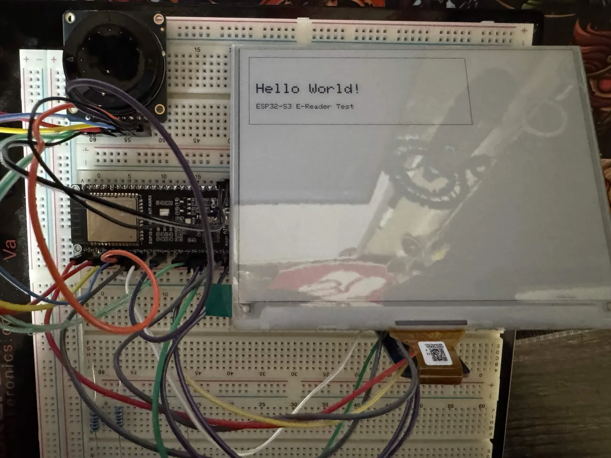

# 008 — SD card and E Ink display

**November 7, 2026**

The microSD breakout arrived, and I soldered the header pins onto it. I connected it to the ESP32-S3 using the same SPI clock and MOSI pins as the E Ink display.

It didn't work the first time. The card was formatted as exFAT, so I used Rufus to format it as FAT32. I was still getting `f_mount failed (3)`, though, so that wasn't the whole problem.

I tested the card-detect pin next. The ESP32 correctly reported when I inserted and removed the card. Then I disconnected the display, dropped the SD clock to 1 MHz, and ran a simpler test. This time it initialized.

After that I had it write `Hello from my e-reader!` to `/test.txt` and read the file back over serial. Both worked. It's a 128 GB card; the test reported a capacity of 116 GiB.

I reconnected the display and tried a combined program. It read the first line of `test.txt` from the SD card and drew that text on the GDEH0576T81. That worked too. The code is under [`firmware/sd-display-test/`](../../firmware/sd-display-test/).

One problem still needs fixing: the original ANO rotary encoder used GPIO9 and GPIO10, and those are now the SD card's CS and MISO pins. I've also got a reported overlap with GPIO11 in the current breadboard setup. I'll need to move the rotary wiring and test it again. I haven't verified all three parts working together yet.

This isn't running inside CrossPoint. The custom CrossPoint build still needs its SD pins and storage code updated, and I haven't loaded an EPUB yet.

## Test photo

